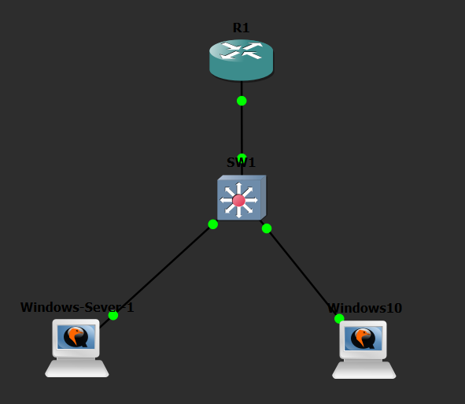
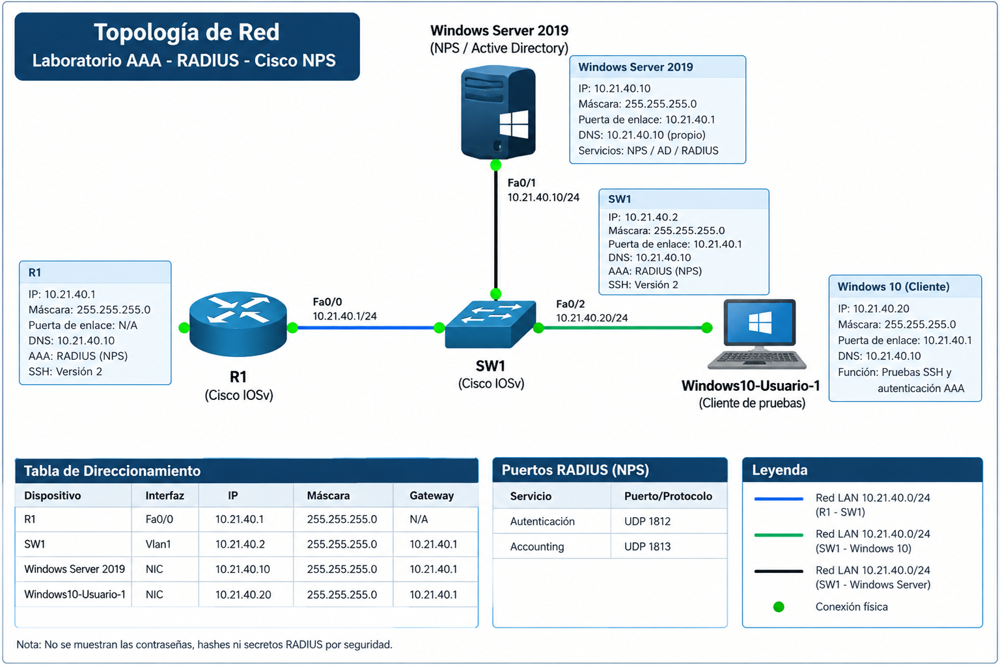

# Lab-AAA-Radius-Cisco-NPS

Laboratorio de seguridad de red desarrollado en **GNS3** utilizando **Cisco IOS**, **Windows Server 2019 (Active Directory + NPS/RADIUS)** y un cliente **Windows 10**.

El objetivo principal es implementar **autenticación, autorización y accounting (AAA)** centralizados mediante RADIUS (NPS), con segmentación de privilegios por grupos de Active Directory (niveles 0, 5 y 10), acceso SSH restringido y registro de todos los eventos de acceso.

## Índice de la documentación

1. [Objetivo y alcance](#objetivo-y-alcance)
2. [Video de demostración](#video-de-demostración)
3. [Topología](#topología)
4. [Direccionamiento IP](#direccionamiento-ip)
5. [Configuración del Router (R1)](#configuración-del-router-r1)
6. [Configuración del Switch (SW1)](#configuración-del-switch-sw1)
7. [Servidor (Windows Server 2019)](#servidor-windows-server-2019)
8. [Procedimiento de implementación](#procedimiento-de-implementación)
9. [Evidencias y pruebas realizadas](#evidencias-y-pruebas-realizadas)
10. [Validación y resultados](#validación-y-resultados)
11. [Conclusiones y limitaciones](#conclusiones-y-limitaciones)
12. [Documentos de respaldo](#documentos-de-respaldo)

## Objetivo y alcance

Implementar AAA centralizado en **R1 y SW1** usando **RADIUS/NPS**, con cuentas de **Active Directory** y privilegios diferenciados (0, 5 y 10). El alcance incluye conectividad IPv4, clientes RADIUS, políticas de red, acceso SSH, autorización de sesión EXEC y registro de eventos. **No se debe confundir la asignación de un nivel de privilegio con la demostración de autorización individual de todos los comandos**: esta última requiere pruebas específicas.

## Video de demostración

> (https://www.youtube.com/watch?v=-24O1OOiTzQ)

---

## Topología

### Topología real en GNS3



### Diagrama de la topología



La topología está compuesta por:

- **R1** – Router Cisco IOS, gateway de la red y cliente RADIUS.
- **SW1** – Switch Cisco IOSvL2, administración y cliente RADIUS.
- **Windows Server 2019** – Controlador de dominio (Active Directory) y servidor NPS/RADIUS.
- **Windows 10** – Equipo cliente para las pruebas de acceso SSH.

### Relación física principal

```text
Windows 10 (10.21.40.20)
   |
   | SSH
   v
R1 (10.21.40.1)  <----RADIUS---->  Windows Server 2019 (10.21.40.10)
   |                                     |
   |                                     +-- Active Directory (seguridad.lab)
   |                                     +-- NPS (POL_RADIUS_NIVEL0/5/10)
   |
SW1 (10.21.40.2) <----RADIUS----> Windows Server 2019 (10.21.40.10)
```

---

## Direccionamiento IP

| Dispositivo | Interfaz | Dirección IP | Máscara | Gateway | Función |
|---|---|---|---|---|---|
| R1 | FastEthernet0/0 | 10.21.40.1 | 255.255.255.0 (/24) | — | Router y puerta de enlace |
| SW1 | VLAN 1 | 10.21.40.2 | 255.255.255.0 (/24) | 10.21.40.1 | Administración del switch |
| Windows Server 2019 | Interfaz de red | 10.21.40.10 | 255.255.255.0 (/24) | 10.21.40.1 | Servidor NPS/RADIUS y Active Directory |
| Windows 10 (cliente) | Interfaz de red | 10.21.40.20 | 255.255.255.0 (/24) | 10.21.40.1 | Equipo de pruebas SSH |

Red: `10.21.40.0/24`

### Parámetros RADIUS

| Parámetro | Valor |
|---|---|
| Servidor RADIUS/NPS | 10.21.40.10 |
| Puerto de autenticación | UDP 1812 |
| Puerto de accounting | UDP 1813 |
| NAS de R1 | 10.21.40.1 |
| NAS de SW1 | 10.21.40.2 |
| Origen de pruebas SSH | 10.21.40.20 |

### Verificación de conectividad y DNS

Todos los equipos documentados pertenecen a `10.21.40.0/24`. R1 utiliza FastEthernet0/0 como interfaz de la red; SW1 utiliza VLAN 1 para administración y `10.21.40.1` como puerta de enlace. El cliente Windows 10 utiliza `10.21.40.10` como DNS del dominio. Antes de probar RADIUS, se comprueba conectividad entre el servidor NPS y las IP de administración de los dispositivos.

[Plan de direccionamiento ampliado](Direccionamiento/Direccionamiento.md)

---

## Configuración del Router (R1)

Se configuró AAA con RADIUS (NPS) y fallback a usuario local.

### AAA implementado

- `aaa new-model`
- Autenticación: `RAD_LOGIN` (RADIUS) con fallback `local`.
- Autorización EXEC: `RAD_EXEC` (RADIUS) con fallback `local`.
- Accounting EXEC: `RAD_ACCOUNT` (start-stop) hacia RADIUS.
- Usuario local: `adminlocal` (privilegio 15).
- AAA aplicado a puertos de consola y auxiliar (vty usa RADIUS para SSH).
- Logs de autenticación/autorización habilitados (`login on-failure/success log`).
- Servicio SSH v2 habilitado (`ip ssh version 2`).
- RADIUS: servidor `10.21.40.10`, puertos UDP 1812 (auth) / 1813 (acct).

[Running-config de R1](Show%20running-config/Show%20running-config%20Router%20R1.txt)

## Configuración del Switch (SW1)

- `aaa new-model`
- Autenticación: `RAD_LOGIN` (grupo RADIUS `GRP_NPS`) con fallback `local`.
- Autorización EXEC: `RAD_EXEC` con fallback `local`.
- Accounting EXEC: `RAD_ACCOUNT` (start-stop) hacia RADIUS.
- Usuario local: `adminlocal` (privilegio 15).
- AAA aplicado a puertos de consola y auxiliar.
- Logs de autenticación/autorización habilitados.
- Servicio SSH v2 habilitado.
- RADIUS: servidor NPS `10.21.40.10`, puertos UDP 1812 (auth) / 1813 (acct).

[Running-config de SW1](Show%20running-config/Show%20running-config%20Switch%20SW1.txt)

---

## Servidor (Windows Server 2019)

### Active Directory

- Dominio: `seguridad.lab`
- Unidad organizativa: `OU_RADIUS`
- Grupos creados:
  - `GRP_RADIUS_NIVEL0`
  - `GRP_RADIUS_NIVEL5`
  - `GRP_RADIUS_NIVEL10`

### NPS / RADIUS

Clientes RADIUS registrados:

| Cliente | IP | Estado |
|---|---|---|
| R1_ROUTER | 10.21.40.1 | Habilitado |
| SW1_SWITCH | 10.21.40.2 | Habilitado |

Políticas de red configuradas:

- `POL_RADIUS_NIVEL0`
- `POL_RADIUS_NIVEL5`
- `POL_RADIUS_NIVEL10` (condición: pertenencia a `SEGURIDAD\GRP_RADIUS_NIVEL10`)

La configuración gráfica del servidor se documenta en:

[Configuración Windows Server (PDF)](Configuracion%20windows%20server/Configuracion%20windows%20server%20.pdf)

---

## Evidencias y pruebas realizadas

Las evidencias documentan, entre otras, las siguientes validaciones:

- Topología general del laboratorio (R1, SW1, servidor Windows, cliente Windows 10).
- Configuración IPv4 estática del servidor (10.21.40.10).
- Usuarios y grupos de Active Directory (`OU_RADIUS`, niveles 0/5/10).
- Clientes RADIUS registrados en NPS (R1 y SW1).
- Políticas de red habilitadas (NIVEL0, NIVEL5, NIVEL10).
- Inicio de sesión SSH con usuario de nivel 0 (modo EXEC reducido).
- Prueba SSH con usuario de nivel 5.
- Registros de contabilidad (accounting) de NPS (eventos hacia R1 y SW1).
- Resultado de pruebas `test aaa group` (autenticación exitosa, privilegios 0/5/10).
- Conexión SSH al router R1 desde Windows.

[Consultar las capturas y pruebas originales en el PDF de evidencias](Evidencias/Evidencias.pdf)

---

## Procedimiento de implementación

### 1. Preparación de la red

1. Construir la topología de GNS3 con R1, SW1, Windows Server 2019 y Windows 10.
2. Configurar las interfaces según la tabla de direccionamiento y verificar que los equipos pertenezcan a la subred `10.21.40.0/24`.
3. Establecer la puerta de enlace de administración del switch hacia R1.
4. Configurar en el cliente Windows 10 el DNS del servidor `10.21.40.10`, necesario para resolver recursos del dominio.

### 2. Active Directory

1. Preparar el dominio `seguridad.lab` en Windows Server 2019.
2. Crear la unidad organizativa `OU_RADIUS`.
3. Crear los grupos `GRP_RADIUS_NIVEL0`, `GRP_RADIUS_NIVEL5` y `GRP_RADIUS_NIVEL10`.
4. Crear las cuentas `usuario_nivel0`, `usuario_nivel5` y `usuario_nivel10` y asociarlas a sus respectivos grupos.

**Propósito:** mantener las identidades y la pertenencia a grupos en un único directorio, en lugar de administrar una cuenta distinta en cada equipo Cisco.

### 3. Network Policy Server (NPS)

1. Instalar y habilitar el servicio NPS en Windows Server.
2. Registrar los clientes RADIUS `R1_ROUTER` (`10.21.40.1`) y `SW1_SWITCH` (`10.21.40.2`).
3. Configurar para cada cliente el secreto compartido correspondiente **sin publicarlo en el repositorio**.
4. Crear las políticas `POL_RADIUS_NIVEL0`, `POL_RADIUS_NIVEL5` y `POL_RADIUS_NIVEL10` y vincular sus condiciones a los grupos de Active Directory.
5. Configurar los atributos de autorización que entregan el nivel de privilegio previsto para cada grupo.
6. Habilitar el registro de solicitudes y revisar los eventos en los registros de NPS.

### 4. Configuración AAA y SSH en Cisco

1. Habilitar AAA mediante `aaa new-model`.
2. Registrar el servidor NPS (`10.21.40.10`) y los puertos RADIUS de autenticación y accounting.
3. Aplicar la lista de autenticación `RAD_LOGIN` con RADIUS y alternativa local.
4. Aplicar la lista de autorización de sesión `RAD_EXEC` con RADIUS y alternativa local.
5. Configurar `RAD_ACCOUNT` para accounting EXEC con registros `start-stop`.
6. Habilitar SSH v2 y asociar las listas AAA a las líneas de acceso remoto.
7. Conservar el usuario local `adminlocal` como mecanismo alternativo de administración.

**Referencia verificable:** las configuraciones completas, con secretos ocultos, se encuentran en los archivos [R1](Show%20running-config/Show%20running-config%20Router%20R1.txt) y [SW1](Show%20running-config/Show%20running-config%20Switch%20SW1.txt). Los pasos anteriores describen la secuencia funcional, no sustituyen las configuraciones guardadas.

### 5. Pruebas desde Windows 10

Abrir CMD o PowerShell y conectarse al router o switch por SSH con cada cuenta:

```powershell
ssh usuario_nivel0@10.21.40.1
ssh usuario_nivel5@10.21.40.1
ssh usuario_nivel10@10.21.40.1

ssh usuario_nivel0@10.21.40.2
ssh usuario_nivel5@10.21.40.2
ssh usuario_nivel10@10.21.40.2
```

> Cada comando corresponde a una sesión distinta; cerrar la sesión anterior antes de probar la siguiente. No publicar contraseñas.

En cada sesión se verifican los privilegios y los comandos visibles:

```text
show privilege
show ?
```

El resultado esperado del primer comando es el nivel correspondiente al usuario autenticado. `show ?` permite observar la ayuda disponible, pero por sí solo **no prueba** que un comando prohibido sea rechazado por una política de autorización.

### 6. Registros de accounting

Consultar los registros de NPS en Windows Server (directorio utilizado en la práctica: `C:\Windows\System32\LogFiles`). Correlacionar, cuando el registro lo permita, la cuenta, el cliente RADIUS, el resultado y el momento de la solicitud. Distinguir los registros de autenticación de los registros de inicio/cierre de sesión.

---

## Validación y resultados

| Comprobación | Dispositivo / sistema | Evidencia documentada |
|---|---|---|
| Topología y direccionamiento | GNS3 / Windows | Diagramas y configuración IPv4 |
| Usuarios y grupos | Active Directory | Cuentas y grupos de niveles 0, 5 y 10 |
| Clientes y políticas | NPS | Clientes R1/SW1 y políticas de red |
| Autenticación RADIUS | Cisco / NPS | Pruebas `test aaa group` con autenticación satisfactoria |
| Niveles de privilegio | R1 y SW1 | Sesiones SSH y `show privilege` para niveles 0, 5 y 10 |
| Comandos visibles | R1 y SW1 | `show ?` en sesiones de usuario |
| Auditoría | NPS | Registros de eventos de acceso |

**Interpretación:** la evidencia de niveles de privilegio respalda la autorización de sesión EXEC. La autorización de comandos específicos solo debe considerarse validada cuando se haya registrado la ejecución permitida o denegada de esos comandos; no se presume por el nivel numérico.

## Conclusiones y limitaciones

La práctica documenta una arquitectura AAA centralizada en la que NPS consulta las identidades de Active Directory y R1/SW1 actúan como clientes RADIUS. Las pruebas muestran la autenticación y la diferenciación de niveles de privilegio. El accounting proporciona trazabilidad de las solicitudes y sesiones registradas por NPS.

**Limitación documental:** las capturas detalladas del servidor y de las pruebas se conservan en PDF. Para visualizarlas de forma individual dentro de GitHub, será necesario exportar las páginas/capturas originales a PNG y añadirlas como imágenes Markdown en las secciones correspondientes. No se han creado capturas nuevas ni se han atribuido resultados no verificados.

## Documentos de respaldo

- [Evidencias completas en PDF](Evidencias/Evidencias.pdf).
- [Configuración visual de Windows Server en PDF](Configuracion%20windows%20server/Configuracion%20windows%20server%20.pdf).
- [Plan de direccionamiento](Direccionamiento/Direccionamiento.md).
- [Configuración sanitizada de R1](Show%20running-config/Show%20running-config%20Router%20R1.txt).
- [Configuración sanitizada de SW1](Show%20running-config/Show%20running-config%20Switch%20SW1.txt).

---

## Running Config

Se incluyen las configuraciones actuales de los dispositivos:

- [R1 running-config](Show%20running-config/Show%20running-config%20Router%20R1.txt)
- [SW1 running-config](Show%20running-config/Show%20running-config%20Switch%20SW1.txt)

> **Nota de seguridad:** los archivos publicados en `Show running-config/` fueron sanitizados. Las contraseñas, hashes y otros valores sensibles se reemplazaron por `<REDACTED>` o se omitieron del extracto público.

---

## Estructura del repositorio

```text
Lab-AAA-Radius-Cisco-NPS/
├── README.md
├── Configuracion windows server/
│   └── Configuracion windows server .pdf
├── Direccionamiento/
│   └── Direccionamiento.md
├── Evidencias/
│   └── Evidencias.pdf
├── Show running-config/
│   ├── Show running-config Router R1.txt
│   └── Show running-config Switch SW1.txt
└── Topologia/
    ├── Diagrama.png
    └── Topologia.png
```

---

## Tecnologías utilizadas

- GNS3
- Cisco IOS / IOSvL2 15.2
- Windows Server 2019 (Active Directory + NPS)
- Windows 10
- RADIUS (UDP 1812/1813)
- SSH v2

---

## Objetivos cumplidos

El laboratorio demuestra una arquitectura de seguridad basada en **AAA centralizado con RADIUS (NPS)**, utilizando **Cisco IOS** y **Windows Server 2019**.

La implementación aplica autenticación y autorización en los dispositivos de red, restringe el acceso a puertos de consola y auxiliar, diferencia privilegios por grupos de Active Directory (niveles 0, 5 y 10), habilita el servicio SSH y registra (accounting) todos los eventos de acceso hacia el servidor NPS.

---

## Autor

**Carlos-2140**

Proyecto desarrollado como práctica de configuración y seguridad de redes con Cisco IOS, Active Directory y NPS/RADIUS en GNS3.
