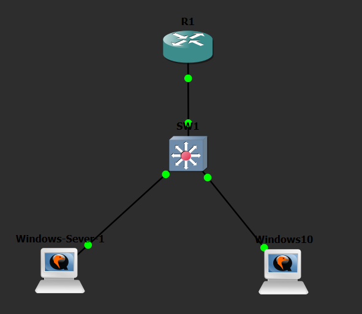
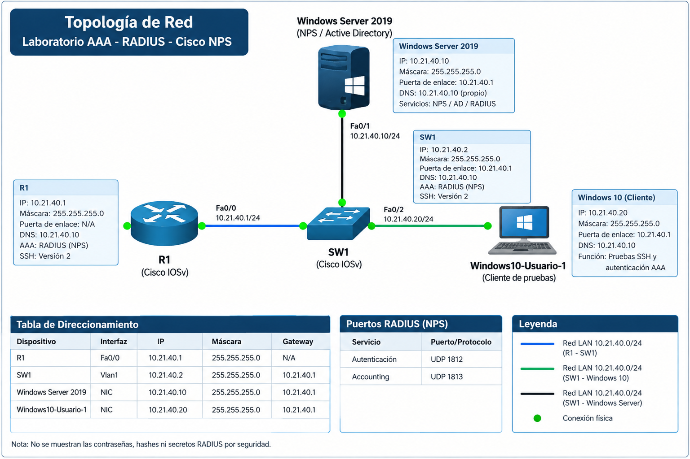

# Lab-AAA-Radius-Cisco-NPS

Laboratorio de **Autenticación, Autorización y Accounting (AAA)** implementado con **Cisco IOS**, **Windows Server 2019 (Active Directory + NPS/RADIUS)** y un cliente **Windows 10**.

> 🎬 **Video demostrativo:** [Ver en YouTube](https://www.youtube.com/watch?v=REEMPLAZAR_CON_TU_ENLACE) *(máximo 10 minutos)*

---

## 🎯 Propósito del laboratorio

Demostrar la implementación de **seguridad de redes** mediante AAA centralizado con RADIUS (NPS), garantizando que:

- Solo usuarios autenticados acceden a los dispositivos de red.
- La autorización se basa en grupos de Active Directory (niveles 0, 5 y 10).
- Se registran (accounting) todos los eventos de acceso.
- Se aplican privilegios diferenciados por nivel de usuario.

---

## 🗺️ Topología





### Infraestructura
| Dispositivo | Rol | IP |
|---|---|---|
| R1 | Router + cliente RADIUS | 10.21.40.1 |
| SW1 | Switch + cliente RADIUS | 10.21.40.2 |
| Windows Server 2019 | Active Directory + NPS/RADIUS | 10.21.40.10 |
| Windows 10 (cliente) | Equipo de pruebas | 10.21.40.20 |

Red: `10.21.40.0/24`

---

## 📁 Estructura del repositorio

```
Lab-AAA-Radius-Cisco-NPS/
├── README.md
├── Configuracion windows server/
│   └── Configuracion windows server .pdf   # Configuración de AD y NPS
├── Direccionamiento/
│   └── Direccionamiento.md                 # Direccionamiento IP y parámetros RADIUS
├── Show running-config/
│   ├── Show running-config Router R1.txt   # Running-config de R1
│   └── Show running-config Switch SW1.txt  # Running-config de SW1
└── Topologia/
    ├── Topologia.png
    └── Diagrama.png
```

---

## 🔐 Configuración AAA

### Router (R1) y Switch (SW1)
- `aaa new-model`
- Autenticación RADIUS (`RAD_LOGIN`) con fallback local.
- Autorización EXEC (`RAD_EXEC`) con fallback local.
- Accounting EXEC (`RAD_ACCOUNT`) hacia NPS.
- Usuario local `adminlocal` (privilegio 15) para consola/auxiliar.
- AAA aplicado **solo a puertos de consola y auxiliar** (vty usa RADIUS para SSH).
- Logs de autenticación/autorización habilitados (`login on-failure/success log`).
- Servicio SSH v2 habilitado.
- RADIUS: servidor `10.21.40.10`, puertos UDP 1812 (auth) / 1813 (acct).

### Servidor (Windows Server 2019)
- Active Directory con dominio `seguridad.lab`.
- Unidad organizativa `OU_RADIUS` con grupos:
  - `GRP_RADIUS_NIVEL0`
  - `GRP_RADIUS_NIVEL5`
  - `GRP_RADIUS_NIVEL10`
- Servicio NPS con clientes RADIUS `R1_ROUTER (10.21.40.1)` y `SW1_SWITCH (10.21.40.2)`.
- Políticas de red: `POL_RADIUS_NIVEL0`, `POL_RADIUS_NIVEL5`, `POL_RADIUS_NIVEL10`.

---

## 📄 Documentación

- [Direccionamiento IP](Direccionamiento/Direccionamiento.md)
- [Configuración Windows Server (PDF)](Configuracion%20windows%20server/Configuracion%20windows%20server%20.pdf)
- [Running-config R1](Show%20running-config/Show%20running-config%20Router%20R1.txt)
- [Running-config SW1](Show%20running-config/Show%20running-config%20Switch%20SW1.txt)

---

## 🎥 Video demostrativo

El video (máximo 10 minutos) debe mostrar:
- Hora y fecha del sistema.
- Cara y voz del autor.
- Demostración de que la topología cumple su objetivo de seguridad de redes.

🔗 Enlace: [https://www.youtube.com/watch?v=REEMPLAZAR_CON_TU_ENLACE](https://www.youtube.com/watch?v=REEMPLAZAR_CON_TU_ENLACE)

---

## 📝 Notas

- Las contraseñas y claves RADIUS se almacenan cifradas (tipo 7) en los running-configs; se recomienda no exponer secretos en repositorios públicos.
- Los scripts utilizados (si aplica) deben agregarse en una carpeta `Scripts/`.
- Cada infraestructura requiere su propio repositorio y video (esta es la infraestructura del laboratorio AAA/RADIUS).